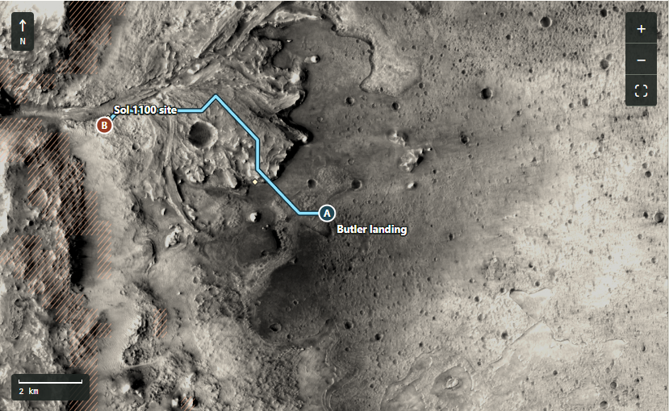

#  Ahmed Abdelghafar Mohamed

I study computer science at Egyptian Chinese University. I built an offline planner because I wanted my timetable, notes, and deadlines in one place. My latest project takes a small detour from campus to Mars.

[LinkedIn](https://www.linkedin.com/in/ahmed-el-zoghby-8320ab278) · [Email](mailto:zoghby2007@gmail.com) · [Browse my repositories](https://github.com/zoghby-ctrl?tab=repositories)

## 🛰️ Latest build · Marswalk

**How would you cross Jezero crater?** My teammate and I built Marswalk as Team Quantumions for NASA Space Apps 2026. Pick two Perseverance sites, tell the planner how much to avoid steep or poorly measured terrain, and see where A* takes you.

The default route covers **9.55 km** and climbs **234 m**. Try increasing the slope penalty and see whether you’d still take the same path.

[Plan a traverse ↗](https://zoghby-ctrl.github.io/quantumions-martian-map/) · [Read the code](https://github.com/zoghby-ctrl/quantumions-martian-map) · [Explore the data sources](https://zoghby-ctrl.github.io/quantumions-martian-map/#sources)

## On Earth

### 🎓 Semester OS

Upload a timetable and turn it into a weekly schedule with rooms, notes, and deadlines. I built it with ECU students in mind. Even the OCR runs in the browser, so your timetable stays on your device.

`TypeScript` `IndexedDB` · [Try the demo semester ↗](https://semester-os-4y6.pages.dev/) · [Source](https://github.com/zoghby-ctrl/semester-os)

### 🚑 Q-Rescue

The shortest predicted trip can still miss a deadline. For my Quantum AI course, I built a research tool that lets you compare candidate emergency routes under uncertain travel times. It runs an exact classical solver and a simulated quantum optimizer on the same choices so you can inspect where they agree.

`Python` `PennyLane` `Streamlit` · [Explore the research and results ↗](https://github.com/zoghby-ctrl/Q-Rescue)

### 🔌 Circuit Copilot

Wire a circuit on a canvas, flip its inputs, and export an Arduino or ESP32 sketch. A browser agent can place components and connect pins on the same canvas you’re looking at.

`TypeScript` `React Flow` `WebMCP` · [Open the canvas ↗](https://circuit-copilot.vercel.app/) · [Source](https://github.com/zoghby-ctrl/Circuit-Copilot)

<strong>More builds · developer tools, city maps, and a game of Pong</strong>

- **[Forge](https://github.com/zoghby-ctrl/Forge)** records the reasoning behind a pull request alongside the diff that supports it. [Open Forge ↗](https://forge-woad-eight.vercel.app/)
- **[Converge](https://github.com/zoghby-ctrl/Converge)** helps inspection teams spot when several urban incident reports come from the same observation. [Explore the map ↗](https://converge-uni-bud.vercel.app/)
- **[Multiplayer Pong](https://github.com/zoghby-ctrl/Multiplayer-Pong-CPP)** is a team-built C++ game. Two clients share a ball over LAN using Win32 sockets and OpenGL.
- **[Smart Assistant Cane](https://github.com/zoghby-ctrl/AI-Smart-Assistant-Cane)** uses an ESP32 and ultrasonic sensors to warn when an obstacle is getting closer.

## GitHub activity

<!-- stats:start -->
**310** contributions in the past year · **16** public repositories · **3** stars across original public repositories · **41** followers

Updated November 18, 2026 · Refreshes weekly
<!-- stats:end -->
