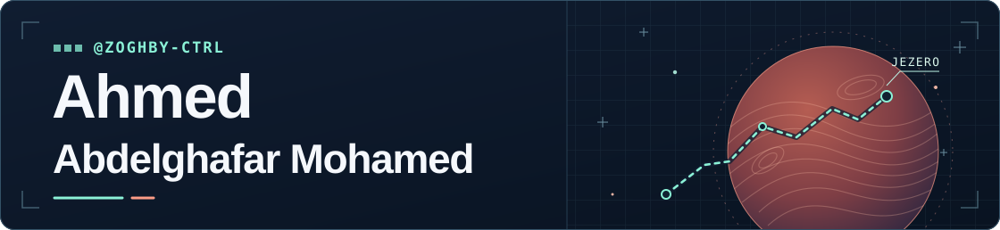

<h1 align="center">
  
</h1>

  <strong>Computer Science undergraduate at Egyptian Chinese University</strong> 
  I build software for students, tools for developers, and the occasional route planner for Mars.

  <a href="https://www.linkedin.com/in/ahmed-el-zoghby-8320ab278">LinkedIn</a> ·
  <a href="mailto:zoghby2007@gmail.com">Email</a> ·
  <a href="https://github.com/zoghby-ctrl?tab=repositories">All repositories</a>

## 🛰️ New releases

**[Marswalk](https://github.com/zoghby-ctrl/quantumions-martian-map)** · [Explore the map ↗](https://zoghby-ctrl.github.io/quantumions-martian-map/) 
Built with Team Quantumions for NASA Space Apps 2026. Plot a traverse across Jezero crater using Mars orbiter imagery, elevation data, and terrain-aware A* routing.

**[Ethics, in Practice](https://github.com/zoghby-ctrl/PracticeEthics)** · [Try a quiz ↗](https://zoghby-ctrl.github.io/PracticeEthics/) 
An offline-capable revision app for computing ethics with 112 source-cited questions, configurable quizzes, and progress saved in the browser.

## ⚡ Featured projects

**[Semester OS](https://github.com/zoghby-ctrl/semester-os)** · [Live beta ↗](https://semester-os-4y6.pages.dev/) 
Import a university timetable and keep notes, assignments, attendance, and study plans in one offline-capable workspace. 
TypeScript · IndexedDB · PWA

**[Q-Rescue](https://github.com/zoghby-ctrl/Q-Rescue)** 
Compare classical route selection with simulated QAOA for emergency-routing scenarios with uncertain travel times. 
Python · PennyLane · Streamlit

**[Circuit Copilot](https://github.com/zoghby-ctrl/Circuit-Copilot)** · [Open canvas ↗](https://circuit-copilot.vercel.app/) 
Build and simulate digital circuits, export Arduino or ESP32 firmware, and let browser agents work on the same canvas via WebMCP. 
TypeScript · Next.js · React Flow

**[Forge](https://github.com/zoghby-ctrl/Forge)** · [Open app ↗](https://forge-woad-eight.vercel.app/) 
Turn a GitHub pull request into a Change Passport that records what changed, why, and what the evidence says. 
Next.js · TypeScript · PostgreSQL

**[Converge](https://github.com/zoghby-ctrl/Converge)** · [Open demo ↗](https://converge-uni-bud.vercel.app/) 
Group reports of urban incidents, distinguish duplicate reports from independent evidence, and prioritize inspections. 
React · FastAPI · MapLibre

**[Multiplayer Pong](https://github.com/zoghby-ctrl/Multiplayer-Pong-CPP)** 
Play synchronized Pong over LAN with a team-built client and server. 
C++ · Win32 sockets · OpenGL

**Side projects** · [ESP32 smart cane](https://github.com/zoghby-ctrl/AI-Smart-Assistant-Cane) · [PatchPilot AI](https://github.com/zoghby-ctrl/PatchPilotAI) · [Jarvis voice assistant](https://github.com/zoghby-ctrl/Jarvis-AI) · Three Ways Out (Unreal Engine)

## 📊 GitHub by the numbers

**308** contributions in the past year 
**16** public repositories 
**3** stars earned · **41** followers

Snapshot taken November 18, 2026.
